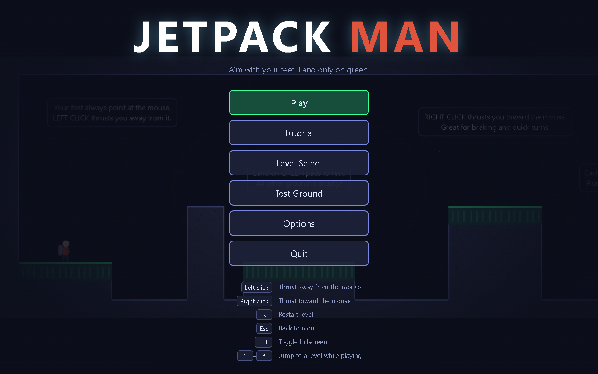
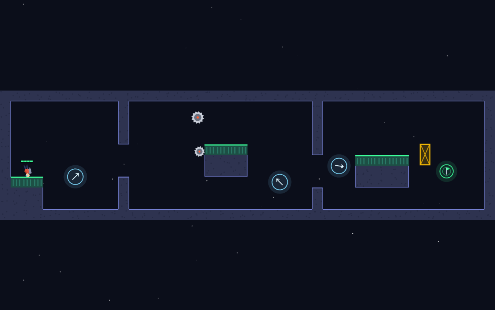
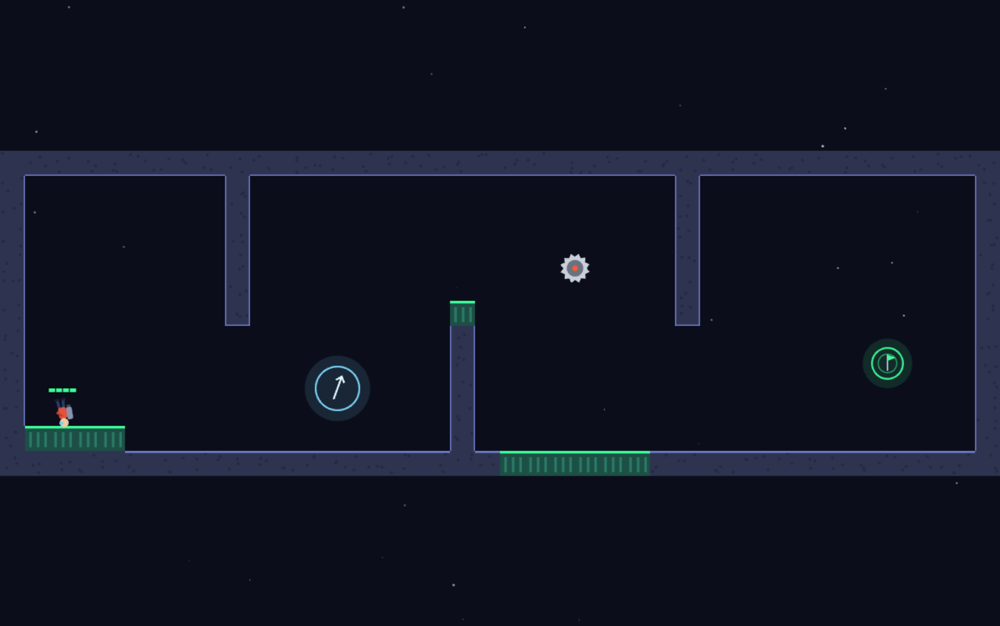
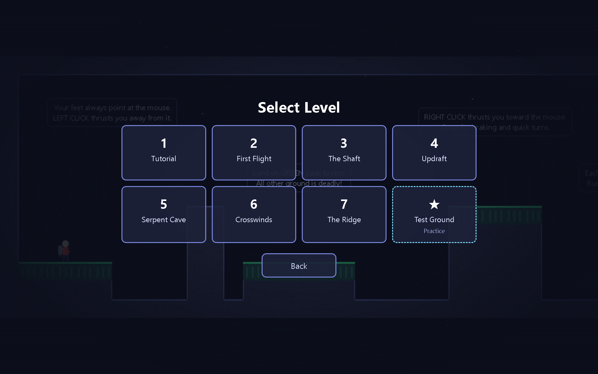
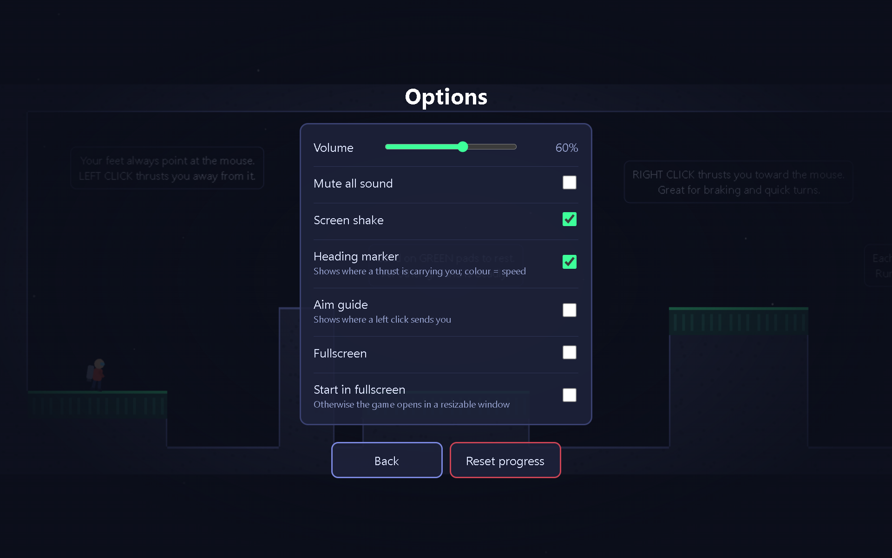
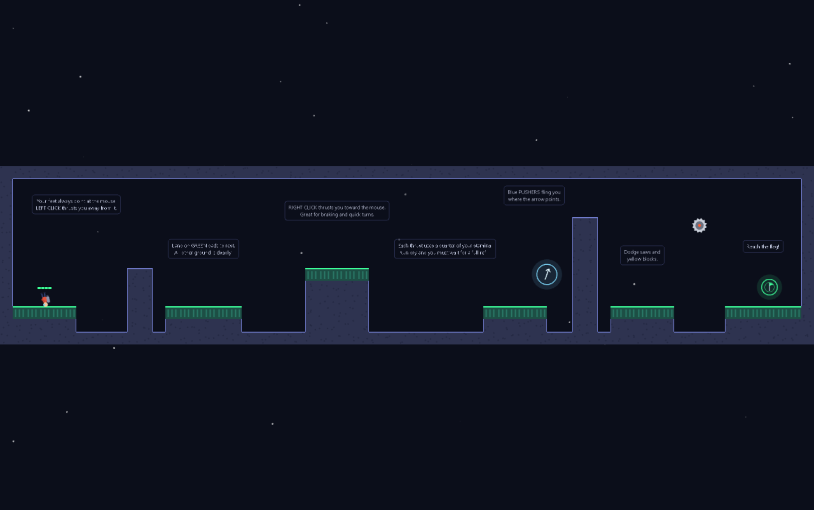
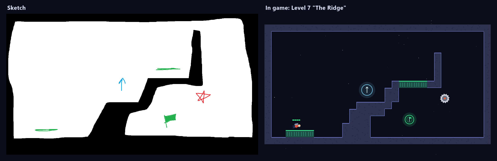

# Devlog #1: From a one-file prototype to a packaged desktop game

*October 17, 2026 · Jetpack Man v1.0.0*



Jetpack Man went from an empty folder to a tested, packaged Windows game in a single day of
back-and-forth. This entry covers how it got there: the idea, the feel tuning, the features
that came and went, and the technical decisions underneath.

---

## The idea

> A small man with a jetpack. You control him entirely with the mouse. His **legs always point at
> the mouse**, and each click **thrusts him the opposite way**. Gravity pulls him down. Touch the
> ground after take-off and he dies. Get from the start platform to the end of the map.

That's the whole game, and almost everything since has been about making that one mechanic
*feel* right.

**Stack:** PixiJS 7 (WebGL 2D rendering) in plain HTML/JS, no bundler, no framework. Later also
NW.js for the desktop build and Node's built-in test runner.

---

## 1. First prototype

The first version was one `index.html`, one `game.js` and one `levels.js`.

- **Levels as ASCII maps.** Each character is a 40px tile: `#` rock, `S` start, `G` goal, `.` air.
  Easy to write by hand, easy to read in a diff.

  ```text
  #################
  #...............#
  #.S..........G..#
  #===......#####.#
  #################
  ```

- **Aiming.** The player sprite is drawn with its feet pointing down (+y), so rotating it by
  `atan2(mouse - player) - 90°` points the legs at the cursor.
- **Collision.** The player is a circle; terrain is a tile grid. Each frame checks only the tiles
  the circle overlaps, finding the closest point of each tile to the circle's centre.
- **Physics** runs in 4 substeps per frame so fast movement can't tunnel through a 40px wall.

## 2. Making it feel good

The first playtest feedback was that **gravity felt stronger than the thrust**: you had to click
several times to recover from a fall. The real cause wasn't gravity, it was *addition*: a thrust
added velocity on top of the existing velocity, so when you were already falling fast, a click
just cancelled the fall.

The fix keeps momentum but makes every click respond:

```js
// Mostly cancel motion fighting the thrust so every thrust responds
const along = p.vx * dir.x + p.vy * dir.y;
if (along < 0) {
  p.vx -= dir.x * along * (1 - cfg.opposingKeep);  // keep 40% of the opposing motion
  p.vy -= dir.y * along * (1 - cfg.opposingKeep);
}
p.vx += dir.x * cfg.thrust;
p.vy += dir.y * cfg.thrust;
```

After that came several rounds of small tuning, each driven by playtesting:

| Setting | Start | Now | Why it changed |
| --- | --- | --- | --- |
| Gravity | 1100 | **520** px/s² | "a little more forgiving", twice |
| Thrust | 400 | **340** px/s | 430 felt too strong once the opposing-cancel went in |
| Terminal fall speed | none | **420** px/s | long drops stay recoverable |
| Stamina refill | none | **32**/s | went 40 → 15 (too slow) → 25 → 32 |

Lesson learned: **change numbers in small steps.** Bigger jumps overshot every time ("now it's too slow").

## 3. Stamina

Unlimited clicking made the game trivial, so thrusts now cost stamina. The rules settled on:

- The bar holds **100**, and each thrust costs **25**, so 4 thrusts. The bar is drawn in 4 segments.
- Any stamina above 0 still allows a thrust, but it always costs 25. A partial bar drains to 0.
- At 0 you're **locked out until the bar is completely full**. While locked out it refills 1.5×
  faster.
- **Landing on a pad refills it instantly**, with a rising "fill-up" sound and a glow on the bar.

The bar floats above the player's head. It's drawn on its own layer, not as a child of the
player sprite, so it never rotates with him.

## 4. Things to fly through: pushers, saws and blocks



**Pushers** started life as rectangular "wind zones" that pushed you with a force and could slowly
rotate. That was the wrong read: what was wanted was **small rings with one fixed direction**,
at any angle. Now:

- touching a pusher **sets** your velocity to its direction × power (one fling per entry, tracked
  with a `touching` flag);
- the ring shows an arrow that nudges in the push direction;
- they were renamed from "boosters" to **pushers** and weakened ~20% after playtesting.

**Moving obstacles** kill on contact:

- **Saws** either ping-pong along a path (`speed` in tiles/s) or circle a point (`speed` in deg/s).
  Their hitbox is 85% of the drawn radius, so grazing a tooth doesn't count.
- **Yellow hazard blocks** slide along paths, with rectangle-vs-circle collision.

Obstacle positions are a pure function of a level clock (`moverPosition(m, t)`), so they're
deterministic and easy to test.

## 5. Landing pads change everything



"Touch the ground and die" made long levels exhausting. **Green landing pads** (`=` in the map) are
safe ground:

- landing on a pad's **top** while falling stands you on it (no gravity while standing);
- its **sides and underside** just block you, they don't kill;
- every level now **starts on a pad**, and has pads as rest stops.

Pads are visually distinct: dark green with a bright green top edge, vs. the blue-grey rock.

## 6. Menus, URLs and progress



The game has three screens on top of gameplay, and **the URL tracks where you are**:

| URL | Screen |
| --- | --- |
| `#/menu` | Main menu |
| `#/levels` | Level select (best times, beaten levels in green) |
| `#/options` | Options |
| `#/level/3` | Playing level 3 |

Back/Forward, refresh and pasted links all land on the right screen. Routing is a tiny pure
function (`parseRoute(hash, levelCount)`) that redirects anything invalid.

Best times are stored in `localStorage` **keyed by level name**, not index. That was a bug fix:
inserting the Tutorial as level 1 shifted every index and made old progress point at the wrong
levels.

## 7. The big refactor (and tests)

At this point everything lived in one 700-line file that mixed physics with drawing, which made it
impossible to test. It was split into:

```text
src/core.js    pure rules: physics, stamina, collisions, pushers, movers, routing, settings
src/levels.js  level data + a tiny map builder
src/audio.js   synthesized sound effects
src/game.js    PIXI rendering, input, menus, glue
```

`core.js` has **no PIXI and no DOM**. It loads as a plain `<script>` in the browser and with
`require()` in Node. The game loop just asks it to step:

```js
for (const e of Core.stepPlayer(world, player, dt)) {
  // 'pusher' | 'landed' | 'dead' | 'won'  -> sounds, particles, screens
}
```

**108 tests** run with `node --test` (no dependencies):

- `tests/core.test.js`: thrust direction, the 4-thrust lockout, cooldown, refill delay, landing
  vs. side hits, rock deaths, pusher behaviour, obstacle paths and collisions, the goal, routing,
  best times, settings sanitising.
- `tests/levels.test.js`: checks **every level** automatically: consistent map width, closed border,
  start on a pad, goal reachable (flood fill), nothing spawned inside rock, obstacles never near
  the start, and *a straight hop from the start lands back safely*.

That last test immediately caught a real bug: in **Crosswinds** the start sat 2.5 tiles under the
ceiling, so your very first thrust killed you. The start was moved to a lower ledge.

Other fixes from the code review:

- a 0.2s "launch grace" let you fly through deadly rock right after take-off (removed; starts are
  pads now);
- thrusting *into* the pad you stand on wasted stamina (now ignored and free);
- the death counter only reset when loading level 1 (now per level).

## 8. Controls, feedback and sound

- **Right click** thrusts *toward* the mouse, which is great for braking.
- **Heading marker:** after a thrust, a small ring appears ahead of the player, showing where
  you're heading. Its colour shows speed (cyan → green → yellow → orange → red), and it
  disappears once the push is used up (the moment you stop moving in the thrust's direction).
- **Sound effects** are all synthesized with WebAudio: no audio files, everything through a
  quiet master gain and a compressor so nothing is harsh. Thrust is a filtered-noise "fwoomp",
  pads play a rising arpeggio, death is a low-passed noise sweep, the win is a soft triangle-wave
  chime.



**Options** (saved in `localStorage`): volume, mute, screen shake, heading marker, aim guide,
and, in the desktop build only, fullscreen and start-in-fullscreen.

## 9. Levels

| # | Level | What it teaches |
| --- | --- | --- |
| 1 | **Tutorial** | In-world signs walk through every mechanic |
| 2 | First Flight | Basic flying, one floating pad |
| 3 | The Shaft | Climbing with rest ledges |
| 4 | Updraft | Pushers |
| 5 | Serpent Cave | Weaving between pillars, one slow saw (rebuilt after "so tough") |
| 6 | Crosswinds | Everything combined |
| 7 | **The Ridge** | Built from a hand-drawn sketch (below) |
| ★ | Test Ground | Huge open practice arena |



### A level from a sketch

The Ridge started as a paint-program drawing. It was 1280×720 pixels, which is exactly 32×18
tiles of 40px, so it could be traced tile by tile. The legend was worked out from the drawing alone:
white = air, black = rock, green lines = pads, blue arrow = pusher, red star = saw, flag = goal.



One deliberate change: the pillar was shortened so the gap above it is 3 tiles. In the sketch it
nearly touched the ceiling, which would have been barely wider than the player.

## 10. Shipping a desktop build

`npm run package` turns the game into a Windows app with **NW.js**:

1. downloads the NW.js runtime from `dl.nwjs.io` (cached in `.cache/nwjs/`);
2. verifies it against the official **SHA-256 checksums**;
3. copies the game in, renames `nw.exe` → `JetpackMan.exe`;
4. zips it as `dist/JetpackMan-1.0.0-win-x64-<date>_<time>.zip`.

Things that came up along the way:

- **Offline.** PixiJS was loaded from a CDN. It's now copied into `vendor/` on `npm install`, with
  the CDN as a fallback.
- **Size.** A build was 564 MB. The NW.js engine itself (`nw.dll`, 308 MB) can't shrink, but 122 MB
  was Chromium UI translations in ~200 languages. Keeping only English brought it to **441 MB
  (198 MB zipped)**.
- **Disk.** Each build is ~640 MB on disk (folder + zip). Older builds keep their zip, but their
  unzipped folder is deleted automatically.
- **Desktop window.** It opens as a resizable 1280×800 window (min 800×560) with normal
  minimize/maximize; fullscreen is an option, and F11 toggles it; there's a Quit button.

### Testing the real .exe

Unit tests don't prove the packaged app actually starts. So the game accepts
`--smoke-test=<file>`: it opens a level, writes a JSON report (PixiJS version, level count, screen,
errors) plus a screenshot, and quits. `npm run test:desktop` runs that against the newest build.

The same hook powers `npm run shot -- <level|menu|levels|options> <file.png>`, which made every
screenshot in this devlog. Two gotchas:

- PixiJS's `extract` API **mangled semi-transparent lines** (the goal ring came out purple), so
  screenshots capture the real window with NW.js `capturePage` instead, with the camera zoomed
  out to fit the whole level.
- A window in the background skips animation frames, so the first Crosswinds shot was stale. The
  tool now forces a render right before capturing.

---

## Where it stands

- 8 levels, tutorial included · 108 passing tests · packaged Windows build
- Docs for future work live in [`docs/`](../docs/) (architecture, level design, workflow)

**Ideas for next time:** a custom `.exe` icon, more levels from sketches, a pause menu,
ghost replays of your best run, and a level editor that reads drawings directly.
